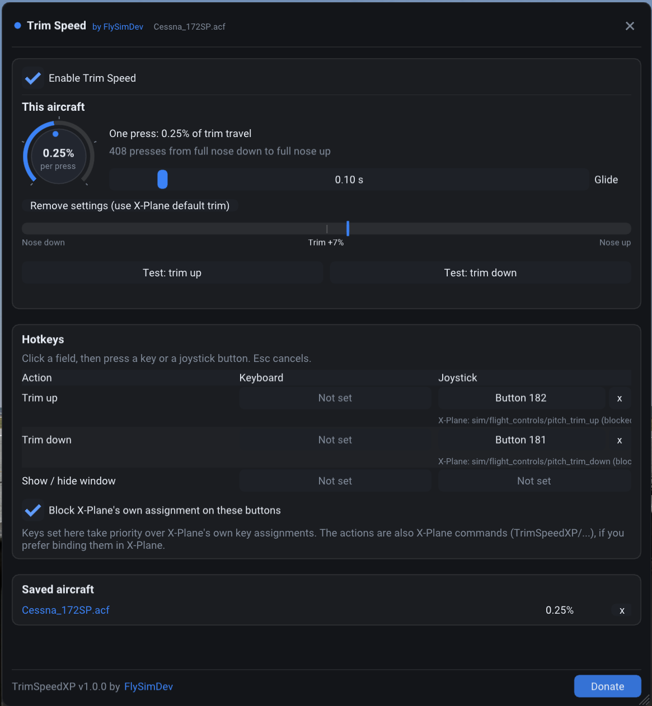

# TrimSpeedXP

### Trim your aircraft in one press, not twenty.

A free X-Plane 12 plugin by **FlySimDev** that makes pitch trim fast, smooth and set up
the way you like it, separately for every aircraft.

---

## Tired of tapping the trim button?

In X-Plane, each press of the trim key moves the trim by a tiny, fixed amount. Climb out,
level off, slow down for the approach, and you're clicking trim over and over, or holding the
button and overshooting. Digital trim wheels, like the one on the Honeycomb Bravo Throttle
Quadrant, have the same problem: every click is just one tiny step, so you spin and spin.

**TrimSpeedXP puts you in control.** You decide how far one press moves the trim, and the trim
glides there smoothly, like the real thing. Set it once per aircraft and forget about it.

## Features

🎯 **Your trim, your step size.** Turn a knob to set exactly how far one press moves the
trim, from ultra-fine to fast.

🌊 **Smooth glide.** The trim moves smoothly to its new position instead of jumping. You
choose how quickly: instant, or up to one second.

✈️ **Remembers every aircraft.** A light Cessna and a heavy jet need different trim. Each
aircraft keeps its own setting and loads automatically.

🎮 **Your keys, your buttons.** Assign any keyboard key or joystick button right in the plugin
window: click a field, then press the key or button. No digging through menus.

🛞 **Made for trim wheels.** Digital trim wheels such as the Honeycomb Bravo's send a button press
with every click. TrimSpeedXP turns each click into exactly the trim movement you want, so a
short turn of the wheel trims like a real one.

🚫 **No double presses.** TrimSpeedXP can block X-Plane's own command on the same joystick button,
so one press always does exactly one thing.

📊 **See your trim.** A live gauge shows where the trim is and how far the next press will move it.

🧩 **Plug and play.** No FlyWithLua, no scripts, no other add-ons. Aircraft you haven't set up
keep X-Plane's normal trim.

## Get flying in a minute

1. **Download** the latest version from [**Releases**](https://github.com/flysimdev/TrimSpeedXP/releases/latest).
2. **Unzip** it and copy the `TrimSpeedXP` folder into `X-Plane 12/Resources/plugins`.
3. **Start X-Plane**, open **Plugins › FSD Trim Speed XP › Show / hide window**, and click
   **Create settings for this aircraft**.
4. **Turn the knob**, assign your trim buttons, and go fly.

The download includes an illustrated **User Guide (PDF)** with step-by-step instructions,
tips and troubleshooting.

## Compatibility

| | |
|---|---|
| **Simulator** | X-Plane 12 |
| **Windows** | 64-bit |
| **macOS** | Intel and Apple Silicon |
| **Linux** | 64-bit |
| **Controls** | Keyboard, joystick and yoke buttons, digital trim wheels (e.g. Honeycomb Bravo) |
| **Aircraft** | Any aircraft with pitch trim, default or add-on |

## Questions

**Does it change aircraft I haven't set up?**
No. Only aircraft you create settings for use TrimSpeedXP. Everything else trims exactly as
before.

**Will it fight my autopilot?**
No. If the autopilot or anything else moves the trim, TrimSpeedXP steps aside straight away.

**Does it work with my trim wheel?**
Yes, if the wheel works as buttons, which is how digital trim wheels such as the Honeycomb
Bravo's work. Assign the wheel like a button: click the *Trim up* field and turn the wheel one
click in the nose-up direction, then do the same for *Trim down*. Wheels click a lot, so a small
step per click (around 0.25 %) usually feels best.

**Can I use X-Plane's own keyboard and joystick settings instead?**
Yes. All actions are also available as X-Plane commands (search for `TrimSpeedXP`).

**Do I lose my settings when I update?**
No. Settings are stored separately from the plugin, so just replace the plugin folder.

## Support the project

TrimSpeedXP is **free**. If it makes your flying easier, a small donation helps FlySimDev keep
building tools for flight simmers. Thank you!

**Found a bug or have an idea?** [Open an issue](https://github.com/flysimdev/TrimSpeedXP/issues).

